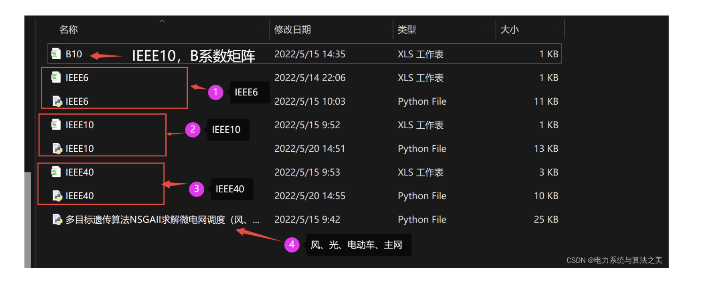

# Particle Swarm Optimization for Solving Electric Power System Environmental Economic Dispatch + Microgrid Dispatch (Python Code Implementation)

Multi-objective Genetic Algorithm NSGAII for Microgrid Scheduling (Wind, Solar, Electric Vehicles, Diesel Engines, Main Grid)

## Images

<!-- PAYMENT_BLOCK -->

## Get this dataset

- Payment link (Stripe): [Buy now](https://buy.stripe.com/3cs8yP7sY87d0vu9AB)
- Payment QR code: 

<!-- /PAYMENT_BLOCK -->
